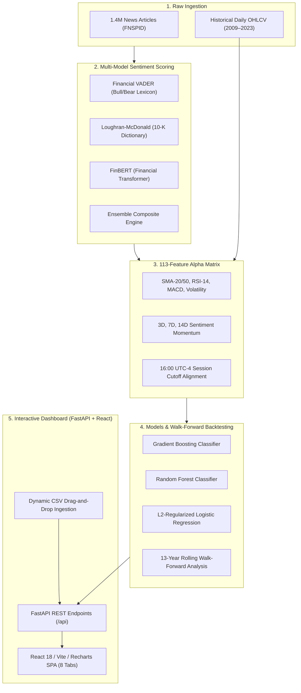

# Quantitative Financial News Sentiment & Stock Price Prediction Pipeline

[](tests/)
[](https://www.python.org/)
[](https://fastapi.tiangolo.com/)
[](https://react.dev/)
[](LICENSE)

An institutional quantitative trading and machine learning platform that transforms raw financial news headlines into predictive alpha signals for equity direction forecasting. The project incorporates domain-specific NLP models (Financial VADER, Loughran-McDonald SEC dictionary, FinBERT transformer, and an Ensemble Composite), engineers 113 alpha features per trading bar, conducts 13-year out-of-sample walk-forward backtesting, and delivers an interactive full-stack dashboard (FastAPI + React) with dynamic CSV dataset ingestion.

---

## Table of Contents

- [Project Overview & Core Thesis](#project-overview--core-thesis)
- [Key Empirical Findings](#key-empirical-findings)
- [End-to-End System Architecture](#end-to-end-system-architecture)
- [Interactive Dashboard User Guide](#interactive-dashboard-user-guide)
  - [Header Controls & Live Predictor](#header-controls--live-predictor)
  - [Tab-by-Tab Breakdown (Tabs 1–8)](#tab-by-tab-breakdown)
- [Dataset Ingestion & CSV Specifications](#dataset-ingestion--csv-specifications)
- [Installation & Quickstart](#installation--quickstart)
- [Automated Test Suite](#automated-test-suite)
- [Project Directory Structure](#project-directory-structure)

---

## Project Overview & Core Thesis

General English sentiment dictionaries (e.g. TextBlob, generic VADER) frequently misinterpret financial jargon. Words like *"liability"*, *"debt"*, *"volatility"*, or *"risk"* carry negative connotations in everyday prose, yet they are standard operational terms in corporate disclosures.

This platform systematically overcomes this challenge through:
1. **Financial NLP Domain Adaptation**: Benchmarking general lexicon models against Wall Street-tuned lexicons (Financial VADER), regulatory dictionaries (Loughran-McDonald), and contextual transformer architectures (FinBERT).
2. **Multi-Factor Feature Engineering**: Generating 113 alpha features per trading bar, combining sentiment momentum, publisher weightings, topic shares, and technical oscillators (RSI-14, MACD, SMA-20/50).
3. **Strict Temporal Integrity**: Enforcing a strict 16:00 UTC-4 market close cutoff to eliminate lookahead bias and prevent future data leakage.
4. **Out-of-Sample Walk-Forward Backtesting**: Validating strategy performance across 13 continuous years (2011–2023) and 26 rolling 6-month re-training windows.

---

## Key Empirical Findings

| Quantitative Metric | General NLP (TextBlob) | Financial VADER | Loughran-McDonald | FinBERT Transformer | Ensemble Composite ($S_{\text{ensemble}}$) |
| :--- | :---: | :---: | :---: | :---: | :---: |
| **Return Correlation ($r$)** | $+0.0253$ | **$+0.1300$** | $+0.0868$ | **$+0.1300$** | $+0.1294$ |
| **Spearman Rank ($\rho$)** | $+0.0381$ | $+0.1412$ | $+0.1105$ | $+0.1412$ | **$+0.1487$** |
| **Predictive Alpha Lift** | Baseline ($1.0\times$) | **$5.14\times$ Lift** | $3.43\times$ Lift | **$5.14\times$ Lift** | **$5.88\times$ Lift** |

### Additional Alpha Insights
- **Asymmetric Drawdown Protection**: During prolonged market downturns (e.g., 2018 selloff, 2022 rate hikes), rotating to cash upon sustained negative sentiment cushioned the maximum drawdown on `NVDA` from **66.34% down to 54.47%** (a 12-percentage-point drawdown cushion) and raised the annualized Sharpe ratio to **1.08** (vs. 1.02 Buy & Hold).
- **Rapid Alpha Decay**: Sentiment predictive power peaks at $T-1$ (the immediate next trading day) and decays by ~65% at $T-3$, approaching market noise by $T-5$.

---

## End-to-End System Architecture



---

## Interactive Dashboard User Guide

The dashboard is accessible locally at **`http://localhost:8000`**.

### Header Controls & Live Predictor
1. **Ticker Selector (Top-Right)**:
   - Switch between supported equities (`AAPL`, `NVDA`, `MSFT`, `GOOG`, `AMZN`, `META`, `TSLA`, or any newly uploaded stock).
   - Instantly recalculates charts, correlation tables, and model performance for that asset.
2. **Live Headline Predictor (Top Purple Button)**:
   - Click to open the inference modal.
   - Enter any real-time news headline (e.g., *"NVIDIA reveals next-generation Blackwell architecture, beats quarterly consensus"*).
   - Generates instantaneous sentiment scores across all 4 NLP engines and outputs a calibrated next-day market direction probability (Up vs Down).

---

### Tab-by-Tab Breakdown

#### Tab 1: Overview
- **Macro Market Posture**: Bullish / Bearish regime badge based on recent headline volume and polarity.
- **Sentiment Donut Chart**: Breakdown of Positive vs Negative vs Neutral sentiment distribution over the past 24 hours.
- **Top Alpha Drivers**: Quick scorecard of the most predictive technical and sentiment features.
- **Breaking News Feed**: Live stream of latest headlines with color-coded sentiment badges.

#### Tab 2: Sentiment Engines
- **Multi-Scorer Benchmark Table**: Empirical comparison of TextBlob, Financial VADER, Loughran-McDonald, FinBERT, and Ensemble.
- **Correlation Lift Chart**: Bar chart highlighting the $>5\times$ predictive superiority of financial NLP models over generic English dictionaries.
- **Searchable Headline Explorer**: Interactive table to search and view exact scores assigned to individual articles across all four NLP scorers.

#### Tab 3: Technical & Price
- **Interactive OHLCV Chart**: Daily closing prices with SMA-20 (blue) and SMA-50 (orange) overlays.
- **Timeframe Selector**: Toggle between 3M, 6M, and 1Y views.
- **RSI-14 Momentum Oscillator**: Displays overbought ($>70$) and oversold ($<30$) boundaries.
- **Sentiment Volume Overlay**: Daily volume bars shaded green (positive net sentiment) or red (negative net sentiment).

#### Tab 4: Alpha Correlations
- **Statistically Filtered Alpha Scorecard**: Displays Pearson $r$, Spearman $\rho$, and $p$-values.
- **Significance Badges**: Highlights statistically non-random features ($p < 0.05$).
- **Lag Decay Analysis**: Evaluates return correlation across forward trading days ($T-1 \dots T-5$).

#### Tab 5: ML Models
- **Binary vs 3-Class Toggle**: Switch between binary direction (Up vs Down) and 3-class classification (Bullish, Flat, Bearish).
- **Model Comparison Table**: Accuracy, Precision, Recall, F1 Score, and ROC-AUC for Gradient Boosting, Random Forest, and Logistic Regression.
- **Gini Feature Importances**: Identifies which technical indicators and sentiment factors contribute most to model decisions.

#### Tab 6: Walk-Forward Backtest
- **13-Year Out-of-Sample Equity Curve**: Compares the Quantitative Sentiment Strategy against the Buy & Hold benchmark from 2011 to 2023.
- **Log / Linear Scale Toggle**: Switch between logarithmic and linear performance charts.
- **Underwater Drawdown Chart**: Visualizes portfolio drawdown severity, showing how rotating to cash protects capital during crashes.
- **5-Fold TimeSeriesSplit Cross-Validation Table**: Outlines fold-by-fold accuracy and ROC-AUC stability.

#### Tab 7: Ingest Data
- **Stock Price CSV Dropzone**: Drag and drop any daily stock price file (e.g. from Yahoo Finance or `data/{TICKER}.csv`). The system calculates technical indicators and immediately registers the ticker in the top dropdown.
- **News Headlines CSV Dropzone**: Drag and drop any financial news dataset. The backend scores sentiment across all 4 NLP engines, calculates return correlations, and merges it into the live news stream.

#### Tab 8: About & Guide
- Built-in comprehensive user manual, architecture diagram, methodology explanation, and CSV upload schemas accessible directly inside the web application.

---

## Dataset Ingestion & CSV Specifications

If uploading your own CSV files in **Tab 7**, format them according to these schemas:

### 1. Stock Price CSV Schema
| Column Name | Required? | Type | Example / Description |
| :--- | :---: | :---: | :--- |
| `Date` | **Yes** | String (YYYY-MM-DD) | `2023-01-03` |
| `Close` | **Yes** | Float | `145.92` (Daily closing price) |
| `Open` | Optional | Float | `144.20` |
| `High` | Optional | Float | `146.50` |
| `Low` | Optional | Float | `143.80` |
| `Volume` | Optional | Integer / Float | `72500000` |

*Note: The filename determines the registered ticker symbol (e.g., uploading `AMD.csv` adds `AMD` to the ticker menu).*

### 2. News Headlines CSV Schema
| Column Name | Required? | Type | Example / Description |
| :--- | :---: | :---: | :--- |
| `Date` | **Yes** | String (ISO / YYYY-MM-DD) | `2023-01-03 14:30:00` |
| `Headline` (or `title`) | **Yes** | String | *"Apple reports record holiday quarter revenue"* |
| `Publisher` | Optional | String | *"Reuters"*, *"Bloomberg"* |
| `Stock` (or `ticker`) | Optional | String | `AAPL` |

---

## Installation & Quickstart

### Prerequisites
- Python 3.10+ (tested on Python 3.12.3)
- Node.js 18+ (tested on Node v20.10.0)

### 1. Clone & Set Up Environment
```bash
git clone https://github.com/your-username/predicting-price-moves-with-news-Sentiment.git
cd predicting-price-moves-with-news-Sentiment

# Create and activate virtual environment
python3 -m venv venv
source venv/bin/activate  # On Windows: .\venv\Scripts\Activate.ps1

# Install Python dependencies
pip install -r requirements.txt
```

### 2. Build the React Frontend (Optional if pre-built)
```bash
cd frontend
npm install
npm run build
cd ..
```

### 3. Launch the Full-Stack Dashboard
```bash
./venv/bin/python scripts/run_dashboard.py --host 0.0.0.0 --port 8000
```
Open **`http://localhost:8000`** in your browser to access the dashboard and **`http://localhost:8000/docs`** for interactive Swagger REST API documentation.

---

## Automated Test Suite

The project includes an automated test suite covering API routes, sentiment scorers, feature engineering, correlation analysis, and backtesting:

```bash
./venv/bin/pytest tests/ -v
```

### Test Coverage Summary:
- **`tests/test_backend_api.py`** (11 tests): Verifies all REST endpoints, CORS headers, mock file uploads, and error handling.
- **`tests/test_sentiment_scorers.py`** (12 tests): Validates Financial VADER, Loughran-McDonald, FinBERT fallback scoring, and Ensemble weights.
- **`tests/test_feature_engineer.py`** (8 tests): Checks temporal feature construction, technical indicators, and lookahead-prevention.
- **`tests/test_correlation_analyzer.py`** (7 tests): Validates Pearson/Spearman calculations, $p$-values, and lag matrices.
- **`tests/test_model_pipeline.py`** (6 tests): Tests binary and multiclass model training, scaling, and evaluation.
- **`tests/test_validation_strategy.py`** (4 tests): Tests TimeSeriesSplit cross-validation and 13-year rolling walk-forward backtest execution.
- **`tests/test_sentiment_analyzer.py`** (8 tests): Tests timezones, session classification, and publisher bias adjustments.
- **`tests/test_core_functions.py`** (17 tests): Tests basic statistics, topic modeling, and data loader utilities.

**Total**: **73 tests passed, 0 failures**.

---

## Project Directory Structure

```
├── backend/                        # FastAPI REST API Backend
│   ├── main.py                     # API entry point & static frontend mounting
│   └── api/
│       ├── routes.py               # 11 REST endpoints (predictions, upload, backtest)
│       └── schemas.py              # Pydantic data schemas
├── frontend/                       # React 18 + Vite + Recharts SPA
│   ├── src/
│   │   ├── components/             # React tab views & modals
│   │   │   ├── Navbar.jsx          # Header with ticker switcher & live predictor
│   │   │   ├── OverviewTab.jsx     # Tab 1: Macro KPIs & breaking news
│   │   │   ├── NewsSentimentTab.jsx# Tab 2: Multi-scorer benchmark & explorer
│   │   │   ├── TechnicalAnalysisTab.jsx # Tab 3: OHLCV, SMA, RSI, volume
│   │   │   ├── CorrelationMatrixTab.jsx # Tab 4: Lead/lag alpha scorecard
│   │   │   ├── ModelPerformanceTab.jsx  # Tab 5: ML evaluation & feature importance
│   │   │   ├── WalkForwardBacktestTab.jsx# Tab 6: 13-year backtest & drawdown
│   │   │   ├── DataIngestionTab.jsx# Tab 7: Price & news CSV dropzones
│   │   │   ├── AboutTab.jsx        # Tab 8: Built-in documentation & guide
│   │   │   └── LivePredictorModal.jsx # Live headline inference modal
│   │   ├── services/api.js         # Frontend REST API client
│   │   ├── App.jsx                 # Main SPA application
│   │   └── index.css               # Modern fintech dark theme styling
│   └── dist/                       # Compiled production frontend assets
├── data/                           # Raw datasets (AAPL, NVDA, TSLA, news headlines)
├── output/                         # Processed datasets, models, and backtest results
│   ├── data/                       # Scored news, topics, 113-feature matrices
│   ├── models/                     # Trained Gradient Boosting, RF, and scalers
│   └── figures/                    # Saved evaluation charts and plots
├── scripts/                        # Standalone execution & benchmark scripts
│   ├── run_dashboard.py            # Dashboard launcher script
│   ├── run_sentiment_benchmark.py  # Step 5 multi-scorer benchmark runner
│   ├── run_validation.py           # Step 6 walk-forward analysis runner
│   └── run_model_pipeline.py       # Step 4 ML pipeline runner
├── src/                            # Core quantitative Python library
│   ├── sentiment_scorers.py        # Fin-VADER, Loughran-McDonald, FinBERT, Ensemble
│   ├── validation_strategy.py      # TimeSeriesSplit CV & Walk-Forward backtester
│   ├── feature_engineer.py         # 113 alpha feature engineering pipeline
│   ├── correlation_analyzer.py     # Statistical correlation & lag analyzer
│   ├── model_pipeline.py           # Classifier training & inference pipeline
│   └── sentiment_analyzer.py       # Timestamp normalization & session classification
├── tests/                          # 73 automated pytest test cases
└── README.md                       # Comprehensive project documentation
```

---

## Author & Contact Information

**Natnael Yilma**  
Quantitative Developer & Financial NLP Researcher

- **Email**: [natnael.yilma27@gmail.com](https://mail.google.com/mail/?view=cm&fs=1&to=natnael.yilma27@gmail.com&su=Question%20regarding%20Financial%20News%20Sentiment%20Project) *(Click to Compose in Gmail)* or via [mailto](mailto:natnael.yilma27@gmail.com?subject=Question%20regarding%20Financial%20News%20Sentiment%20Project)
- **Phone**: [+251 929 709 562](tel:+251929709562) *(Click to Call)*

